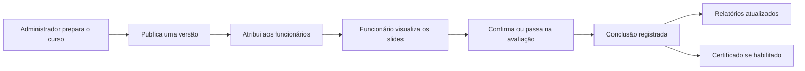
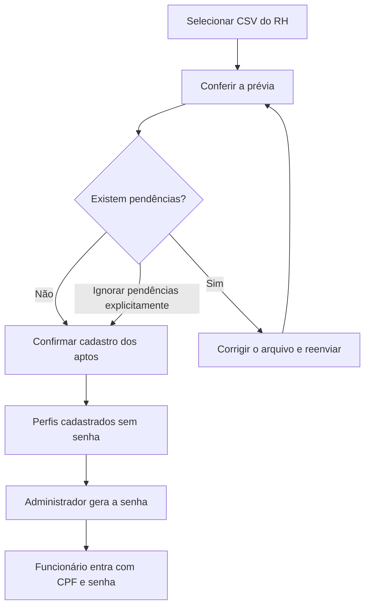
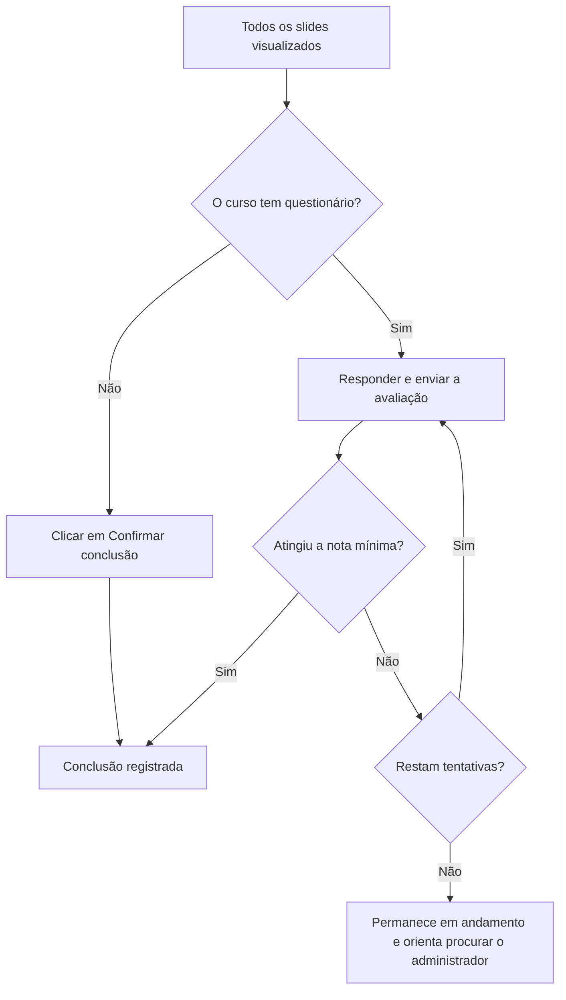
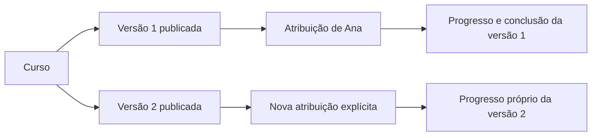
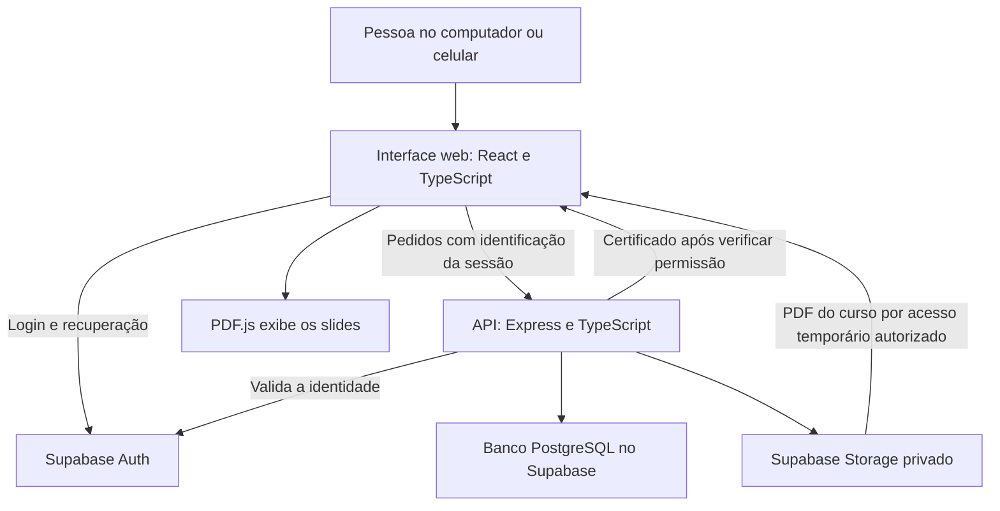
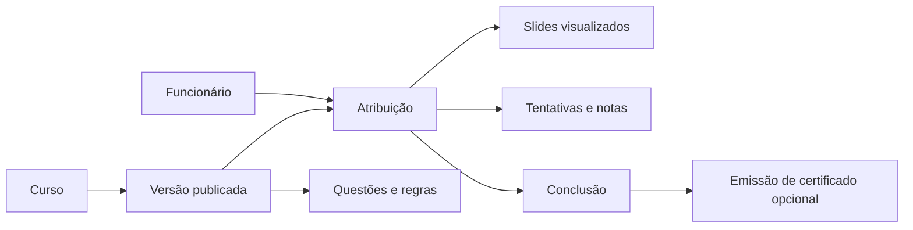

# Cifra Academy — Guia da plataforma

**Treinamentos da empresa organizados em um só lugar: do cadastro de funcionários ao acompanhamento das conclusões.**

A Cifra Academy é uma plataforma de treinamento corporativo acessada pelo navegador, em computadores e celulares. A empresa disponibiliza apresentações em PDF, escolhe quem deve estudar cada conteúdo e acompanha o andamento. O funcionário acessa seus treinamentos, percorre os slides, responde à avaliação quando houver e baixa o certificado quando esse recurso estiver habilitado.

Este guia descreve a implementação presente no repositório em **27 de outubro de 2026**. Ele explica o produto; não representa uma confirmação de que todos os recursos estejam configurados em qualquer ambiente de hospedagem.

> Comece pelas seções 1 a 4 para entender o uso no dia a dia. A parte técnica está no final. Os diagramas usam Mermaid: abra o arquivo em um visualizador Markdown com suporte a Mermaid. Cada diagrama também tem uma explicação em texto.

## Neste guia

- [1. A plataforma em um minuto](#1-a-plataforma-em-um-minuto)
- [2. Quem usa e o que pode fazer](#2-quem-usa-e-o-que-pode-fazer)
- [3. Caminho do administrador](#3-caminho-do-administrador)
- [4. Caminho do funcionário](#4-caminho-do-funcionário)
- [5. Avaliações, progresso e conclusão](#5-avaliações-progresso-e-conclusão)
- [6. Certificados](#6-certificados)
- [7. Relatórios e acompanhamento](#7-relatórios-e-acompanhamento)
- [8. Versões e preservação de registros](#8-versões-e-preservação-de-registros)
- [9. Como funciona por dentro](#9-como-funciona-por-dentro)
- [10. Limites e dúvidas frequentes](#10-limites-e-dúvidas-frequentes)
- [11. Referências para a equipe técnica](#11-referências-para-a-equipe-técnica)

## 1. A plataforma em um minuto

Imagine que a empresa precisa orientar a equipe sobre um procedimento de segurança. O administrador prepara um PDF, cria o curso, configura uma avaliação opcional e publica o conteúdo. Depois, seleciona os funcionários que precisam realizá-lo. Cada pessoa recebe o treinamento na própria área da plataforma, e a administração acompanha os resultados.

**Em palavras:** preparar → publicar → atribuir → estudar → concluir → acompanhar.

Três conceitos ajudam a entender tudo o que vem depois:

| Conceito   | Significado                                         | Exemplo ilustrativo                                            |
| ---------- | --------------------------------------------------- | -------------------------------------------------------------- |
| Curso      | O treinamento que a empresa organiza.               | Integração de novos funcionários.                              |
| Versão     | Uma edição do conteúdo e das regras do curso.       | Versão 1 com o procedimento inicial; versão 2 com uma revisão. |
| Atribuição | O vínculo entre uma pessoa e uma versão específica. | Ana precisa realizar a versão 2 da integração.                 |

Uma mesma pessoa pode ter vários treinamentos. Um mesmo curso pode ser atribuído a várias pessoas. O progresso pertence a cada atribuição.

## 2. Quem usa e o que pode fazer

| Perfil                | Para que serve                                            | Principais possibilidades                                                                                                           |
| --------------------- | --------------------------------------------------------- | ----------------------------------------------------------------------------------------------------------------------------------- |
| Funcionário / usuário | Participar dos treinamentos.                              | Acessar os próprios cursos, continuar de onde parou, responder avaliações, consultar o histórico e baixar os próprios certificados. |
| Administrador         | Organizar e acompanhar a capacitação.                     | Gerenciar funcionários e cargos, criar e publicar cursos, atribuir treinamentos e consultar ou exportar relatórios.                 |
| Conta suprema         | Administrar também a concessão do papel de administrador. | Acessar a visão ampliada de contas e promover usuários ativos a administradores.                                                    |

A conta suprema é uma condição especial de uma conta administrativa. Não é um perfil que alguém escolhe ao entrar na plataforma.

**Cargo não é permissão de acesso.** Associar alguém ao cargo “Supervisor”, por exemplo, não transforma essa pessoa em administrador.

### Onde encontrar cada recurso

| Área              | Quem utiliza  | O que aparece                                                           |
| ----------------- | ------------- | ----------------------------------------------------------------------- |
| Visão geral       | Administrador | Indicadores da equipe, panorama dos treinamentos e conclusão por curso. |
| Cursos            | Administrador | Criação, edição de rascunhos, publicação, atribuição e arquivamento.    |
| Usuários          | Administrador | Cadastro, importação, dados dos funcionários e gestão de acesso.        |
| Cargos            | Administrador | Cadastro de cargos e associação a usuários.                             |
| Relatórios        | Administrador | Progresso, situação, datas, tentativas e exportação CSV.                |
| Meus treinamentos | Funcionário   | Cursos atribuídos e acesso ao conteúdo.                                 |
| Meu histórico     | Funcionário   | Treinamentos concluídos e certificados emitidos.                        |

## 3. Caminho do administrador

### 3.1 Cadastrar funcionários e liberar o acesso

O cadastro pode ser manual ou feito pela importação de um arquivo **CSV**, formato de tabela que pode ser exportado por planilhas e sistemas de RH.

Na importação, a plataforma apresenta uma prévia antes de cadastrar. Ela identifica registros desligados, campos inválidos e duplicações. Os registros com data de desligamento são ignorados. Duplicidades de CPF ou e-mail não sobrescrevem pessoas já cadastradas.

Os dados mantidos incluem nome, CPF, e-mail de contato opcional, estado extraído de “Cidade / UF”, centro de custo e função profissional informada em “Cargo Atual”. Essa função profissional é separada do vínculo administrado na tela **Cargos**.

**Em palavras:** importar não libera o login imediatamente. Primeiro nasce o cadastro; depois o administrador gera a senha pela coluna **Ações**. Se houver pendências, é necessário corrigir o arquivo ou escolher **Ignorar pendências** para cadastrar somente os aptos.

O funcionário novo entra com os 11 dígitos do CPF, sem pontuação, e a senha gerada. O e-mail de RH é um contato, não o identificador desse novo acesso. Contas antigas preservam o login por e-mail.

A senha gerada aparece no modal e é descartada da interface ao fechar. Se for necessário gerar outra, a nova substitui a anterior. A recuperação por e-mail não se aplica aos acessos técnicos baseados em CPF; nesses casos, o funcionário procura o administrador.

### 3.2 Organizar cargos

Em **Cargos**, o administrador cria um nome e uma descrição opcional, edita o cadastro e seleciona usuários ativos para associá-los ao cargo.

Cada usuário tem no máximo um cargo. Uma nova associação substitui o cargo anterior apenas para os selecionados. Excluir um cargo deixa essas pessoas sem o vínculo, preservando suas contas e seus treinamentos.

### 3.3 Preparar e publicar um curso

1. Abra **Cursos** e crie um treinamento.
2. Preencha título e descrição e envie a apresentação em PDF.
3. Se necessário, configure as perguntas, as alternativas corretas, a nota mínima e o limite de tentativas.
4. Se desejar certificado, habilite a emissão e confira a prévia.
5. Salve o rascunho e publique a versão quando o material estiver pronto.
6. Abra **Atribuir** e selecione os funcionários que deverão realizar o treinamento.

**Publicar e atribuir são ações diferentes.** Publicar prepara o conteúdo para distribuição; atribuir faz o treinamento aparecer para os funcionários selecionados.

Ao abrir a seleção, usuários ativos já vinculados à versão aparecem marcados como **Já atribuído**. Essa janela acrescenta novas atribuições; desmarcar uma pessoa não remove um vínculo existente.

## 4. Caminho do funcionário

1. Entre com seu CPF e senha, ou com e-mail no caso de contas antigas.
2. Abra **Meus treinamentos** e escolha um curso atribuído a você.
3. Use **Anterior** e **Próximo** para percorrer os slides.
4. Confira a indicação **Progresso salvo**. Se houver falha, use a opção de tentar salvar novamente.
5. Depois de visualizar todas as páginas, confirme a conclusão ou responda ao questionário.
6. Consulte **Meu histórico** e, quando disponível, baixe o certificado.

Você pode sair e voltar depois: a plataforma retoma o último slide registrado. Treinamentos concluídos continuam disponíveis para revisão enquanto a atribuição existir.

| Situação exibida | O que significa                                                                      | Próximo passo                                             |
| ---------------- | ------------------------------------------------------------------------------------ | --------------------------------------------------------- |
| Não iniciado     | O treinamento foi atribuído, mas ainda não foi iniciado.                             | Começar treinamento.                                      |
| Em andamento     | O treinamento foi iniciado, mas os critérios de conclusão ainda não foram atendidos. | Continuar os slides ou cumprir a etapa final.             |
| Concluído        | A conclusão foi registrada conforme as regras daquela versão.                        | Revisar o conteúdo ou consultar o certificado, se houver. |

## 5. Avaliações, progresso e conclusão

O progresso mede a quantidade de **slides diferentes visualizados**, em relação ao total. Ver a mesma página várias vezes não aumenta esse total. Uma página conta depois de ser exibida e ter o registro salvo.

> **100% dos slides não significa, sozinho, treinamento concluído.** Ainda é preciso confirmar a conclusão ou obter aprovação na avaliação, conforme o curso.

Sem avaliação, a pessoa confirma após visualizar todas as páginas. Com avaliação, precisa alcançar a nota mínima. Se não conseguir, pode tentar novamente até o limite configurado.

As questões têm uma alternativa correta e o mesmo peso. A nota de aprovação é comparada sem arredondamento; o arredondamento mostrado na tela não altera o resultado. O questionário só é liberado depois de todas as páginas, e o gabarito não é enviado ao funcionário.

**Exemplo ilustrativo:** em uma avaliação com cinco questões e nota mínima de 80%, acertar quatro questões é suficiente para aprovação.

O limite pertence à atribuição. Publicar uma nova versão não reinicia as tentativas da anterior. Não existe, no fluxo atual, uma ação de reabertura de tentativas esgotadas.

## 6. Certificados

A emissão é opcional e configurada antes da publicação da versão. O administrador marca **Gerar certificado ao concluir?** e abre a prévia para conferir o documento com dados fictícios.

O modelo padrão é fornecido pelo projeto. O nome é obrigatório; CPF, curso, carga horária, data e código podem ser selecionados na configuração. A interface não permite enviar outro modelo nem reposicionar os campos.

Após a conclusão oficial, o sistema registra os dados da emissão. No primeiro download, gera o PDF e o guarda para os próximos acessos. Uma falha ao gerar o arquivo permite tentar novamente sem desfazer a conclusão do treinamento.

- **No treinamento:** aparece a opção de baixar o certificado quando configurado e concluído.
- **Em Meu histórico:** ficam listados os certificados emitidos para o participante.
- **Preservação:** certificados emitidos mantêm os dados e o modelo originais, inclusive após exclusão do curso ou limpeza de relatórios.

A data do certificado usa o fuso de São Paulo. Habilitar certificados posteriormente não emite documentos retroativos para conclusões antigas. O código identifica a emissão; não há fluxo público de validação de certificado documentado na interface atual.

## 7. Relatórios e acompanhamento

A **Visão geral** resume usuários cadastrados, cursos publicados, treinamentos em andamento e concluídos. Também mostra a conclusão por curso, considerando as atribuições de suas diferentes versões.

Os números de treinamento representam **atribuições**, não pessoas únicas. Por exemplo: dez funcionários com dois cursos atribuídos a cada um representam vinte atribuições.

Em **Relatórios**, o administrador filtra por usuário, curso e situação. A consulta mostra:

- Pessoa, curso e versão atribuída.
- Situação e percentual de slides visualizados.
- Datas de início e conclusão.
- Quantidade de tentativas e notas da avaliação.

**Exportar CSV** baixa os dados conforme os filtros selecionados, para análise em uma planilha. As datas da interface seguem o fuso local do navegador; a exportação usa os valores de data fornecidos pela API.

A plataforma também registra eventos de auditoria, como ações administrativas e conclusões. Esses registros ajudam a rastrear o que aconteceu, mas **não comprovam atenção ou leitura humana**: visualizar um slide é uma evidência de navegação.

## 8. Versões e preservação de registros

Uma versão publicada não pode ser alterada. Para atualizar o conteúdo, o administrador prepara outra versão, envia um novo PDF e publica novamente. É necessária uma nova atribuição explícita para que alguém realize essa edição.

**Em palavras:** a versão nova não substitui o histórico da antiga. Cada atribuição mantém a referência à edição que a pessoa recebeu.

### Diferenças entre arquivar, excluir e limpar

| Ação                                                  | Efeito principal                                                                                               | O que permanece                                                                                      |
| ----------------------------------------------------- | -------------------------------------------------------------------------------------------------------------- | ---------------------------------------------------------------------------------------------------- |
| Arquivar curso                                        | Bloqueia novas atribuições.                                                                                    | Histórico e acesso às atribuições existentes.                                                        |
| Excluir curso sem apagar atribuições                  | Cursos com atribuições ficam protegidos contra essa exclusão.                                                  | Os vínculos não são removidos por essa opção.                                                        |
| Excluir curso marcando “Apagar também as atribuições” | Remove o curso, versões e registros de treinamento vinculados.                                                 | Auditoria e certificados emitidos; os PDFs permanecem no armazenamento para manutenção controlada.   |
| Desativar usuário                                     | Bloqueia novas requisições protegidas.                                                                         | Cadastro e histórico.                                                                                |
| Excluir usuário                                       | Desativa o perfil e remove a conta de login.                                                                   | Identidade histórica nos relatórios; se o login não puder ser removido, aparece “Exclusão pendente”. |
| Limpar dados em Relatórios                            | Remove todas as atribuições, visualizações, respostas, tentativas e conclusões, independentemente dos filtros. | Cursos, versões, PDFs, contas, auditoria e certificados emitidos.                                    |

> **“Limpar dados” não limpa apenas a tabela visível.** A operação também faz os treinamentos desaparecerem da área dos funcionários após a atualização da tela. É preciso atribuí-los novamente para iniciar outro ciclo.

## 9. Como funciona por dentro

Esta seção é para quem quer entender a tecnologia sem precisar conhecer programação.

A pessoa interage com a interface. O serviço de autenticação cuida do login. A API verifica quem está fazendo cada pedido e executa as operações. O banco guarda cadastros e resultados; o armazenamento guarda os PDFs. O visualizador transforma cada página do PDF em um slide na tela.

| Componente                              | Função em linguagem simples                                          |
| --------------------------------------- | -------------------------------------------------------------------- |
| React, TypeScript e Vite                | Constroem e organizam a aplicação exibida no navegador.              |
| Tailwind CSS e componentes de interface | Definem a apresentação visual e os controles.                        |
| Express e Zod                           | Recebem os pedidos da interface e validam os dados enviados.         |
| Supabase Auth                           | Gerencia autenticação e sessões.                                     |
| PostgreSQL e políticas RLS              | Guardam dados e restringem quais registros cada pessoa pode acessar. |
| Supabase Storage                        | Armazena PDFs em áreas privadas.                                     |
| PDF.js                                  | Exibe as apresentações por páginas.                                  |
| pdf-lib                                 | Preenche e gera os PDFs de certificados.                             |

### Como os registros se conectam

O vínculo central é a atribuição: ela conecta a pessoa à versão do curso e reúne progresso, tentativas e conclusão. Os registros de certificados são preservados mesmo quando os registros de treinamento são removidos pelos fluxos administrativos descritos acima.

O controle de acesso não depende apenas de esconder botões. A API verifica identidade e situação ativa, e o banco também aplica regras de acesso. Chaves privilegiadas pertencem ao servidor, não ao navegador. Os arquivos de certificado são entregues pela API após a verificação de permissão.

## 10. Limites e dúvidas frequentes

| Dúvida                                                            | Resposta                                                                                                                                    |
| ----------------------------------------------------------------- | ------------------------------------------------------------------------------------------------------------------------------------------- |
| Posso enviar vídeo ou PowerPoint diretamente?                     | O fluxo atual recebe apresentações em PDF. Converta o material para PDF antes do envio.                                                     |
| Qual é o limite do PDF?                                           | Até 20 MB e 500 páginas, sem proteção por senha.                                                                                            |
| Qual é o limite da importação CSV?                                | Até 8 MB e 10.000 registros.                                                                                                                |
| O CPF é verificado oficialmente?                                  | A limpeza verifica o formato de 11 dígitos; não comprova titularidade nem valida os dígitos verificadores.                                  |
| Por que meu funcionário não consegue entrar logo após o cadastro? | O cadastro novo começa sem credencial. O administrador precisa gerar a senha.                                                               |
| O curso publicado aparece automaticamente para todos?             | Não. É necessário atribuí-lo aos funcionários desejados.                                                                                    |
| Posso sair no meio do treinamento?                                | Sim. Aguarde o progresso ser salvo para retomar do último slide registrado.                                                                 |
| Todo curso gera certificado?                                      | Não. O recurso precisa estar habilitado na versão realizada.                                                                                |
| Cadastrar cargo distribui cursos automaticamente?                 | Não. Cargo e atribuição de treinamento são operações separadas.                                                                             |
| A plataforma envia notificações automáticas de novos cursos?      | Esse recurso não integra o escopo atual documentado.                                                                                        |
| Funciona sem internet?                                            | Não há modo offline implementado. Login, carregamento e salvamento dependem de conexão.                                                     |
| Desativar alguém apaga o conteúdo já visto?                       | Não. Bloqueia novas requisições; não recolhe informações ou arquivos já carregados no dispositivo.                                          |
| Serve para qualquer escala?                                       | O MVP foi pensado para equipes pequenas. Consultas administrativas ainda processam dados em memória e exigem evolução para volumes maiores. |

## 11. Referências para a equipe técnica

O repositório reúne interface, API, migrações de banco e testes. Não é preciso entender essas pastas para usar a plataforma.

| Caminho                                                        | Conteúdo                                                      |
| -------------------------------------------------------------- | ------------------------------------------------------------- |
| [apps/web/src](apps/web/src)                                   | Telas, navegação, autenticação e visualizador de treinamento. |
| [apps/api/src](apps/api/src)                                   | Regras da API, validações, importação e certificados.         |
| [supabase/migrations](supabase/migrations)                     | Evolução das tabelas, permissões e operações do banco.        |
| [supabase/tests](supabase/tests)                               | Verificações das regras no banco.                             |
| [tests/e2e](tests/e2e)                                         | Testes dos fluxos no navegador.                               |
| [assets/certificado-modelo.pdf](assets/certificado-modelo.pdf) | Modelo padrão usado na emissão dos certificados.              |

Para instalar, configurar e executar localmente, siga o [README](README.md). O projeto requer Node.js 22.13 ou superior e npm; Docker é necessário para os testes descartáveis de banco. O comando `npm run dev` inicia a interface e a API, mas não aplica migrações.

- [Configuração do Supabase](docs/SUPABASE.md): ambientes, autenticação, armazenamento e registros de aplicação de migrações. Confira esse documento antes de qualquer operação no banco.
- [Matriz e roteiro de validação](docs/VALIDATION.md): cenários de teste, evidências registradas e verificações de integração.
- [README técnico](README.md): comandos de lint, tipagem, testes, build e orientações de hospedagem.

Os testes de navegador usam respostas simuladas e não substituem a homologação integrada de autenticação, armazenamento e recuperação de senha. A disponibilidade real dos recursos depende da configuração e das migrações do ambiente utilizado.

**Base deste guia:** telas e rotas da aplicação, tipos de dados, API, migrações e README presentes no repositório. Exemplos com pessoas e cursos neste documento são ilustrativos.
